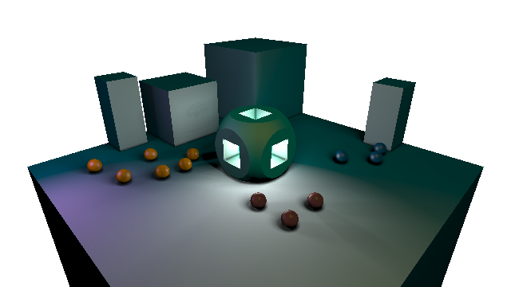

# A simple software signed distance function renderer

This simple demo illustrates the basics of both the sphere tracing method of ray marching and constructive solid geometry modelling with signed distance fields; it has no dependencies and is around six hundred lines of functional Scala.  The renderer is written specifically to run eclusively on the CPU instead of the GPU so as to best illustate the entire rendering pipeline as clearly and concisely as possible.

When run the program produces this image (writing it to disk in PNG format):



To quickly run this program, install `sbt` (the in interactive Scala build tool), clone this reposititory and then from the root of the repository run:

```
sbt run
```

